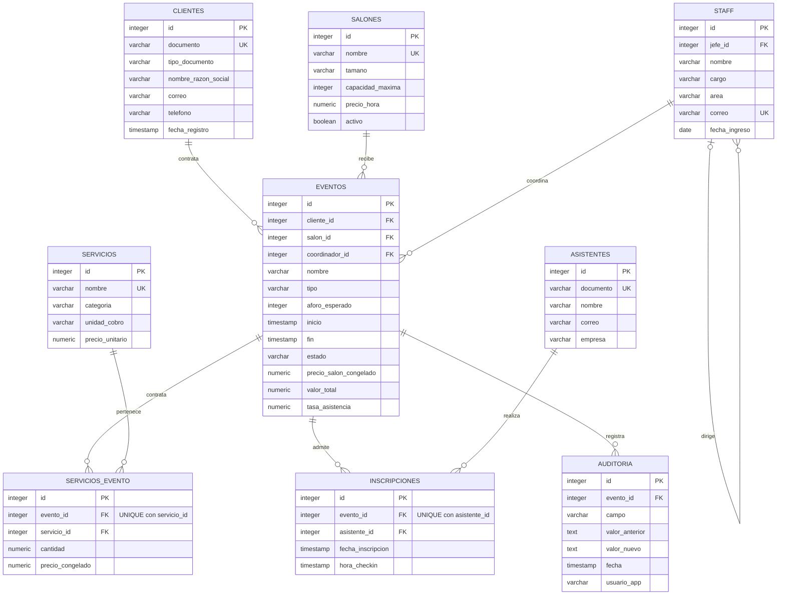

# Diagrama relacional

El modelo tiene nueve tablas. `servicios_evento` resuelve la relación muchos a muchos entre eventos y servicios; `inscripciones` hace lo mismo entre eventos y asistentes. El staff tiene una relación consigo mismo para identificar al jefe inmediato.

Versiones gráficas: [SVG](diagrama_relacional.svg) y [PNG](diagrama_relacional.png). En `diagrama_relacional.html` el gráfico se muestra directamente. El siguiente código conserva las cardinalidades en Mermaid.

`||` representa exactamente uno; `o{`, cero o muchos; `o|`, cero o uno. Un empleado puede no tener jefe, pero cada evento tiene cliente, salón y coordinador obligatorios.

Los datos de cliente, salón, asistente y servicio se almacenan una sola vez. Las tablas puente tienen claves únicas compuestas para impedir duplicar una contratación o una inscripción. El precio congelado es un dato de la contratación, distinto de la tarifa vigente del catálogo. `valor_total` y `tasa_asistencia` se conservan porque el enunciado pide almacenarlos y los triggers mantienen su consistencia.

Las longitudes, la precisión y las restricciones completas están en [diccionario_datos.md](diccionario_datos.md). El esquema generado corresponde a `app/models.py`.
